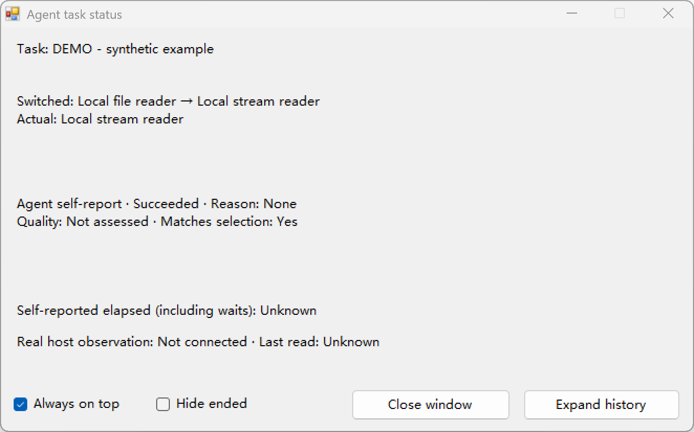

# Agent Tool Center

[English](README.md) | [简体中文](README.zh-CN.md)

**Compare similar agent tools, choose when to intervene, and check what was used.**

Agent Tool Center is a local-first capability advisor with automatic,
explain-and-continue, and manual selection modes. It keeps the selection and
the Agent's adoption report separate. Optional Windows windows display
supported Codex activity metadata alongside Agent reports.

## Try it before configuring a host

With **Node.js 22 or newer** and Git:

```sh
git clone https://github.com/cihuagu/Agent-Tool-Center.git
cd Agent-Tool-Center
node scripts/demo-capability-choice.mjs --mode manual
```

Choose **A** or **B**, then press Enter. A uses `readFile`; B uses
`createReadStream` with `readline`. Only the selected adapter reads the first
three lines of this checkout's README. The final JSON includes selected and
actual capability IDs, matching result, line count, and SHA-256 digest.
Enter `q` to cancel; empty input, invalid input, or EOF executes neither adapter.

This is a real local read through the existing advisor, requiring **no npm
install, account, API key, or Hook configuration**. It uses an isolated
in-memory catalog; it does not connect Codex, discover installed plugins, or
change your chat mode. Availability and adoption remain script/Agent reports;
quality stays `not_assessed`.

Run without `--mode` for automatic selection, or use `--mode recommend` to see
the routing explanation before execution. The prompt is Chinese; candidate
IDs, A/B choices, and the final JSON are also readable in English.

## Decide when to intervene

| Mode | Behavior with multiple relevant, ready candidates |
| --- | --- |
| `auto` — default | Select the existing default route and continue. |
| `recommend` | Explain the route, then continue without a choice approval. |
| `manual` | Wait for the user's choice before starting the selected operation. |

In a connected **current-chat desktop bridge**, ask the Agent to “switch this
chat to manual/recommend/auto” or “show the current mode.” The Agent must call
the bridge and read back the result. Mode is stored locally for that project
and host chat UUID and survives a normal reconnect. The raw stdio interface
and local demo use a mode per comparison/run; they do not read that chat record.

Defaults are routing priorities, **not quality rankings**. The advisor does
not call a paid recommendation model. Choice modes do not grant execution
permission or replace host approvals.

## What works where

| Entry | Requirements | Scope |
| --- | --- | --- |
| Local demo | Node 22+ | Two fixed local readers; no host connection. |
| Six-tool stdio advisor | Node 22+ and locked npm dependencies | Bounded session catalog, compare, select, status, and adoption reports. |
| Current desktop chat | Supported persistent `node_repl`, trustworthy host UUID, dependencies | Explicit project client; saved mode for the current chat. |
| Single-chat / resident windows | Windows, existing .NET Framework WinForms compiler; supported source for real activity | Experimental read-only English/Chinese display; no native macOS/Linux GUI. |
| JSON Hook maintenance | Explicit target, reviewed plan, supported host trust; Windows for apply | Install/update/remove/rollback plans, protected backups, drift checks and receipts. |
| Optional loopback panel | Node + dependencies; `npm run dev` | Separate controlled Git/Node example executor at `127.0.0.1:4173`. |
| ChatGPT integration | — | Not implemented. |

The six metadata tools are `list_capabilities`, `refresh_capabilities`,
`compare_capabilities`, `select_capability`, `report_task_status`, and
`report_capability_use`. They **do not execute the chosen capability**. The
Agent uses its real host tools or loaded method Skills and reports the result.
A method Skill is instructions used by an Agent, not an MCP or CLI endpoint.

## Optional native status window



*Actual Windows window, synthetic example data. Real host observation is not
connected; this image demonstrates the layout, not a live Codex call.*
The single-chat window includes **Hide ended** and **Close window** controls.
They affect display, not the chat or permissions. Closing it does not
cause an automatic reopen.

## Connect an actual workflow

Install the existing locked dependencies from the checkout:

```sh
npm ci --ignore-scripts --no-audit --no-fund --cache .cache/npm-cache
node scripts/doctor.mjs
```

The diagnostic does not install, start, or repair anything. A ready file or
reachable manager does not prove host trust or event delivery; `unknown`
remains meaningful. Windows-specific missing prerequisites on other systems
are reported as such. See the [diagnostic guide](docs/USAGE.md#read-only-diagnostics).

For an existing supported desktop chat, follow the
[current-chat bridge guide](docs/DESKTOP_BRIDGE.md). It checks the current
host-provided UUID and binding before each use; it does not register a global
plugin or open another chat.

Windows checkout entrypoints:

| Entrypoint | Action |
| --- | --- |
| `启动能力选择聊天.cmd` | Open a new Codex CLI chat with the advisor in a terminal. |
| `启动悬浮状态聊天.cmd` | Open a new CLI chat with an opt-in single-chat window. |
| `启动多聊天管理器.vbs` | Start the independent resident manager and native window without opening a terminal. |

Codex launchers require a separately installed, authenticated Codex CLI;
Windows chat launchers require `codex.cmd` on PATH. Setup does not install Codex
or .NET. The resident manager displays Hook metadata, not a global six-tool
service. Opening it alone does not connect every chat.

Preview supported Hooks without installing them:

```sh
node scripts/preview-multi-chat-hooks.mjs
```

Review actual target changes and use the host's supported review/trust process
before any global configuration change. See [installation and maintenance](docs/INSTALLATION.md).
Current maintenance validation includes isolated fixtures and real-file
previews; it does not establish real global uninstall/recovery for every host.

## Boundaries worth knowing

- Catalog entries, readiness, adoption, and quality are Agent self-reports.
  Inclusion is not installation or availability. A returned call is not proof
  that its business result meets the requirement.
- External refresh replaces a complete bounded session snapshot. The catalog
  currently holds at most 256 entries, comparisons at most four. It is not
  whole-machine discovery or visibility into all Codex internal tools.
- Host observations and Agent reports remain separate. Outer `exec` or
  `node_repl` calls remain outer calls; code strings are not parsed to guess
  inner plugins. Coverage depends on the host and version.
- Hook display keeps allowlisted metadata, not raw prompts or tool bodies.
  Local IPC is unauthenticated: local processes could forge or read metadata.
  Host permissions and approvals remain authoritative.

See the [usage and privacy guide](docs/USAGE.md) and [security policy](SECURITY.md).

## Help improve it

Try a real similar-tool choice and tell us what you expected, which entry was
chosen, and whether the result helped. Useful contributions include first-run
reproductions, focused host compatibility fixes, and better task examples.
Keep credentials, private chats, raw Hook input, and personal caches out of
issues and pull requests.

Development checks use `npm test` after installation; process and native tests
run serially and can take several minutes. Optional MCPHub tests skip when
their separately prepared fixture is absent. Platform skips are explicit.
The CI workflow targets Node 22 on Ubuntu and Windows; adding the workflow
alone is not a passing hosted run.

- [Public roadmap](docs/ROADMAP.md) · [Contributing](CONTRIBUTING.md)
- [Documentation index](docs/README.md) · [Usage](docs/USAGE.md)
- [MIT license](LICENSE) · [Third-party notices](THIRD_PARTY_NOTICES.md)
