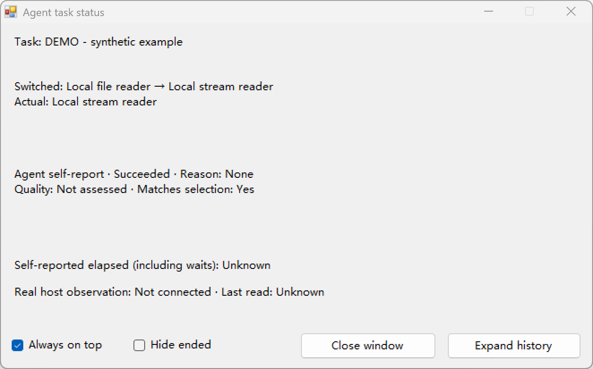

# Agent Tool Center

[English](README.md) | [简体中文](README.zh-CN.md)

**比较相似工具，决定何时人工介入，并核对实际采用了哪个入口。**

Agent Tool Center 是优先在本地运行的能力选择助手，支持自动、解释推荐后继续、
人工选择三种模式，分别记录选择与 Agent 的采用报告。可选 Windows 原生窗口
展示受支持的 Codex 活动元数据，并与 Agent 自报区分。

## 先体验，再配置宿主

准备 **Node.js 22 或更新版本**和 Git：

```sh
git clone https://github.com/cihuagu/Agent-Tool-Center.git
cd Agent-Tool-Center
node scripts/demo-capability-choice.mjs --mode manual
```

输入 **A** 或 **B** 并回车：A 使用 `readFile`，B 使用 `createReadStream` 与
`readline`。选定后，只有所选入口读取当前检出的 README 前三行。最后一行 JSON
给出所选／实际能力 ID、采用一致性、行数与 SHA-256 摘要。
输入 `q` 取消；空输入、无效输入或 EOF 都不会执行任一读取入口。

这次读取真实经过已有能力助手，**无需 npm install、账号、API key 或 Hook 配置**。
它使用独立内存目录，不连接 Codex、不发现已安装插件，也不改变当前聊天模式。
可用性和采用报告仍由脚本／Agent 自报；质量保持 `not_assessed`（未评估），
不冒充用户满意度。

不传 `--mode` 时自动选路；传 `--mode recommend` 时先解释现有确定性路由，再继续执行。

## 决定何时人工介入

| 模式 | 有多个相关且已就绪候选时 |
| --- | --- |
| `auto`（默认） | 按现有默认路由选择并继续。 |
| `recommend` | 先解释推荐依据，再继续，无需确认本次选择。 |
| `manual` | 在执行所选操作前停下，等待用户选择。 |

在已经连接的**当前聊天桌面桥**中，可以直接说“切换到人工／推荐／自动模式”
或“当前模式”。Agent 必须实际调用并读回结果。模式按项目和宿主聊天 UUID
保存在本地，正常重连后保留。原始 stdio 接口和本地演示按次比较／运行传模式，
不读取聊天的模式记录。

默认路由由目录优先值确定，**不是质量排名**；没有调用付费推荐模型。
选择模式不授予执行权限，也不替代宿主审批。

## 当前支持范围

| 入口 | 前提 | 范围 |
| --- | --- | --- |
| 上述本地演示 | Node 22+ | 两个固定本地读取入口，不连接宿主。 |
| 六工具 stdio 助手 | Node 22+、锁文件中的 npm 依赖 | 有界会话目录、比较、换选、状态与采用报告。 |
| 当前桌面聊天 | 受支持的持久 `node_repl`、可信宿主 UUID、项目依赖 | 显式连接项目客户端，保存当前聊天模式。 |
| 单聊／常驻窗口 | Windows、已有 .NET Framework WinForms 编译器；真实活动需受支持观察源 | 实验性只读显示，支持中英文；未提供 macOS/Linux 原生 GUI。 |
| JSON Hook 维护 | 明确目标、已审阅计划、宿主支持的信任；apply 需要 Windows | 安装／更新／卸载／回退计划、受保护备份、漂移检查与收据。 |
| 可选本地面板 | Node 和依赖；`npm run dev` | `127.0.0.1:4173` 上独立的受控 Git/Node 示例执行器。 |
| ChatGPT 接入 | — | 尚未实现。 |

六个元数据工具是 `list_capabilities`、`refresh_capabilities`、
`compare_capabilities`、`select_capability`、`report_task_status`、
`report_capability_use`。它们**不执行所选能力**；实际操作由 Agent 调用真实宿主
工具，或按已加载的方法型 Skill 指令完成。方法型 Skill 是 Agent 使用的指令，
不是 MCP 或 CLI 可执行端点。

## 可选原生状态窗



*真实 Windows 窗口，使用合成示例数据；真实宿主观察未连接。此图展示布局，
不是真实 Codex 调用证据。*
单聊浮窗提供“隐藏已结束”和“关闭浮窗”。这些控件影响显示，不结束聊天或
改变权限；关闭后不会自动重开。

## 接入真实工作流

在检出目录安装已有锁文件依赖：

```sh
npm ci --ignore-scripts --no-audit --no-fund --cache .cache/npm-cache
node scripts/doctor.mjs
```

诊断不会安装、启动或修复任何组件。文件存在、管理器可达，不代表宿主信任或
事件投递已经成立；`unknown` 会如实保留。其他系统缺少 Windows 专属条件时，
会明确报告。详见[诊断说明](docs/USAGE.md#read-only-diagnostics)。

已有的受支持桌面聊天见[当前聊天桥接指南](docs/DESKTOP_BRIDGE.md)。每次使用前
检查宿主提供的真实 UUID 与绑定，不注册全局插件、不另开聊天。

Windows 检出根目录入口：

| 入口 | 行为 |
| --- | --- |
| `启动能力选择聊天.cmd` | 在终端中新开带能力助手的 Codex CLI 聊天。 |
| `启动悬浮状态聊天.cmd` | 新开 CLI 聊天并启用可选的单聊原生窗。 |
| `启动多聊天管理器.vbs` | 启动独立常驻管理器和原生主窗，不打开终端。 |

聊天启动器需要另行安装并认证的 Codex CLI；Windows 入口需要 PATH 中存在
`codex.cmd`。安装项目依赖不会安装 Codex 或 .NET。常驻管理器只显示 Hook
元数据，不是全局六工具服务；打开窗口不等于连接全部聊天。

只预览支持的 Hook，不执行安装：

```sh
node scripts/preview-multi-chat-hooks.mjs
```

实际修改全局配置前，先审阅具体目标变更，再使用宿主支持的审阅／信任流程。
详见[安装与维护](docs/INSTALLATION.md)。当前维护验证包括隔离夹具与真实文件
预览，不能据此保证各宿主、各版本的真实全局卸载／恢复均已通过。

## 使用边界

- 目录条目、就绪状态、采用与质量由 Agent 自报。收录不代表安装或可用；
  调用返回不代表产物满足任务要求。
- 外部刷新原子替换完整的有界会话快照。当前目录总量最多 256，比较最多 4 个
  候选；不是全盘扫描，也不承诺看见 Codex 全部内部工具。
- 真实观察和 Agent 自报分开。外层 `exec`、`node_repl` 保留外层名称，
  不解析代码字符串猜测内部插件。观察覆盖取决于宿主与版本。
- Hook 显示只保留白名单元数据，不保留原始提示或工具正文。本地 IPC 尚未认证，
  其他本地进程可能伪造或读取元数据；宿主权限与审批仍是执行依据。

详见[使用与隐私说明](docs/USAGE.md)和[安全说明](SECURITY.md)。

## 一起改进

欢迎带来真实的相近工具选择场景：你原本期待什么、选了哪个入口、结果是否有用。
首次运行的复现步骤、聚焦的宿主兼容修复和任务样例都很有帮助。
请不要把凭证、私人聊天、原始 Hook 输入或个人缓存放进 issue／PR。

开发验证在安装依赖后运行 `npm test`。进程与原生测试串行运行，可能需要数分钟；
未准备可选 MCPHub 资源时会跳过相关测试，平台专属跳过也会明确报告。
CI 配置面向 Ubuntu／Windows 的 Node 22；仅加入 workflow 不代表远端已经通过。

- [公开路线](docs/ROADMAP.md) · [参与贡献](CONTRIBUTING.md)
- [文档目录](docs/README.md) · [使用指南](docs/USAGE.md)
- [MIT 许可证](LICENSE) · [第三方声明](THIRD_PARTY_NOTICES.md)
